# 👩‍💻 Hi, I'm Saara!

## 🙋🏽‍♀️ About Me

- 🎓 B.Tech in Computer Science & Engineering, specializing in **Artificial Intelligence & Machine Learning**, at **Symbiosis Institute of Technology, Pune**.
- 🤖 Interested in **Agentic AI, multi-agent orchestration, RAG, and intelligent automation**.
- 🧩 I enjoy building practical AI systems that solve real-world problems.
- 🏀 **Captain of the SIT Women's Basketball Team** — bringing teamwork, discipline, and leadership from the court to every project.

## 🛠️ Tech Stack

**Languages & Web**

**AI / ML & Backend**

**Tools & Platforms**

`LangChain` · `CrewAI` · `Hugging Face` · `Pinecone` · `RAG`

<h2 align="center">🚀 Featured Projects</h2>

<h3>🔄 Multi-Agent Document Sync</h3>

An intelligent multi-agent system for detecting document changes, 
tracking dependencies, and automatically synchronizing related documents.

 

`Python` · `CrewAI` · `LangChain` · `RAG` · `Multi-Agent Systems`

 

<h3>🛡️ AI App Monitor</h3>

An AI-powered DevSecOps monitoring platform for real-time process tracking, 
CPU utilization monitoring, application performance analysis, 
and intelligent security insights.

 

`Python` · `FastAPI` · `React` · `DevSecOps` · `AI`

 

<h3>📑 BidPilot AI</h3>

An agentic AI-powered tender automation platform for tender discovery, 
eligibility verification, compliance checking, and bid preparation.

 

`Python` · `Agentic AI` · `Multi-Agent Systems` · `Automation`

 

## 🏆 Achievements

- 🥈 **2nd Place** — TechVortex 3.0 International Agentic AI Competition
- 🏀 **Captain** — SIT Women's Basketball Team
- 🎨 **Head of Media** — SIT ACM Student Chapter

## 🐍 Contribution Snake

<!-- This image appears after the GitHub Actions workflow runs successfully. -->

## 🌐 Connect With Me

 

